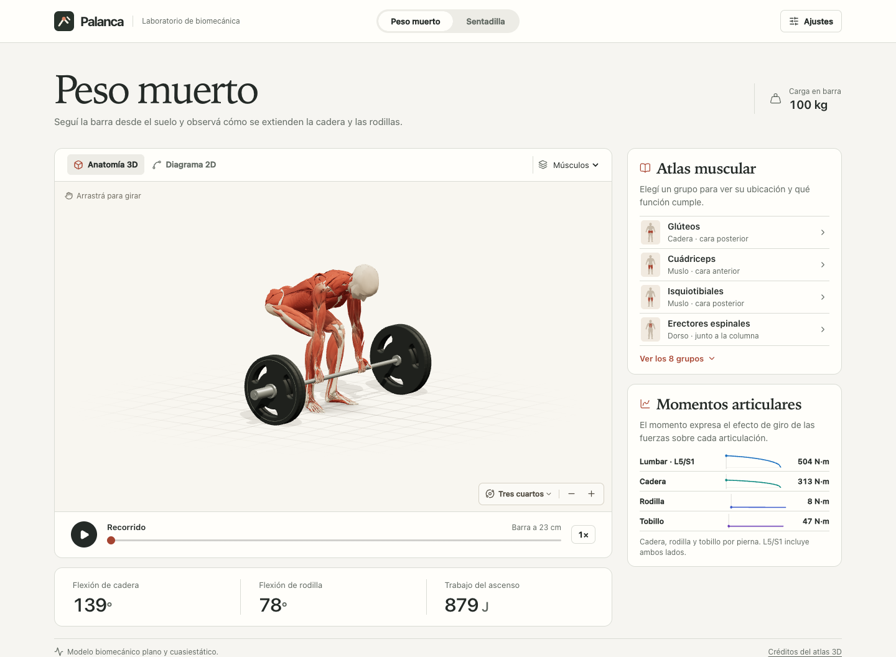

# Palanca

Laboratorio interactivo de **peso muerto y sentadilla**. Explorá el cuerpo en 3D durante una repetición y pasá al diagrama lateral para estudiar la misma postura, sus palancas y sus momentos articulares. Funciona en el navegador.



## Explorar un levantamiento

1. Elegí un ejercicio y reproducí una repetición. Podés pausarla, arrastrar el control de recorrido o tocar **1×** para verla a media velocidad.
2. Girá el modelo o elegí una vista anterior, posterior o de perfil. En el selector de capa podés pasar de **Músculos** a **Esqueleto**. Con el foco en el visor, las flechas giran la cámara, `+` y `−` ajustan el zoom e `Inicio` recupera el encuadre.
3. Seleccioná un músculo en el cuerpo o uno de los ocho grupos del **Atlas muscular**. La ficha explica su función y propone qué observar durante el ejercicio.
4. En **Diagrama 2D**, tocá una articulación o un segmento para modificar la postura. En **Ajustes** podés cambiar carga, proporciones, coordinación y guías, o copiar un enlace a la posición.


## Cómo interpretar los valores

Los huesos y tejidos acompañan los puntos de un modelo sagital cuasiestático. El resaltado muscular permite identificar estructuras. Los números expresan momentos articulares netos en N·m, ángulos y trabajo mecánico del ascenso en J. Los momentos de cadera, rodilla y tobillo se muestran por pierna. L5/S1 corresponde al tronco completo. La activación individual de cada músculo queda fuera del cálculo.

Las mallas anatómicas se sirven junto con la aplicación. Si falla WebGL o la carga de un recurso 3D, sigue disponible el simulador lateral. Ver [fuentes y licencias de los modelos](public/anatomy/creditos.html).

## Desarrollo y verificación

```sh
npm ci
npm run dev
```

```sh
npm run build
npm test
npm run audit:motion
```

La [auditoría de animaciones](docs/auditoria-animaciones.md) reúne los problemas corregidos, los recorridos evaluados y los controles probados en el navegador.
