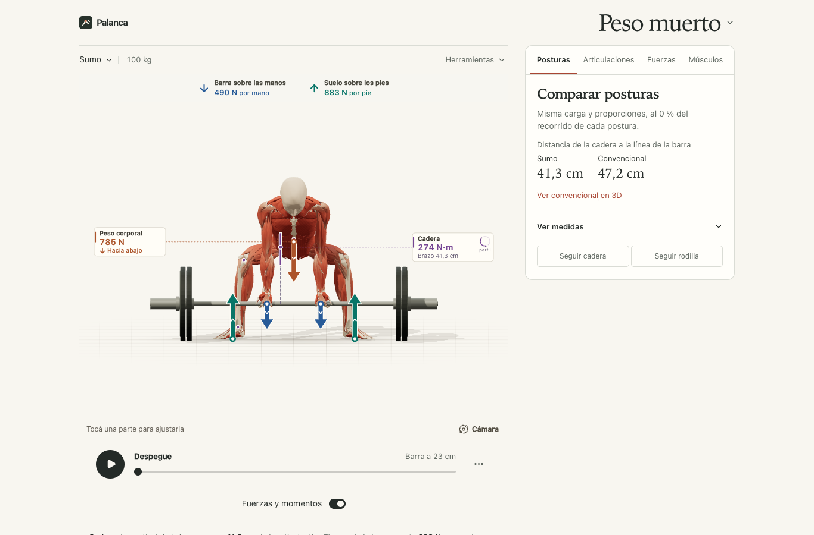

# Palanca

Laboratorio interactivo de **peso muerto, press de banca y sentadilla**. Cambiá la apertura de los pies, el agarre o las proporciones del cuerpo y seguí en 3D cómo se modifican la postura, el recorrido de la barra y los momentos articulares.



## Explorar un levantamiento

1. Tocá el nombre del ejercicio para elegir **Peso muerto**, **Press de banca** o **Sentadilla**. Reproducí el movimiento o arrastrá el deslizador para detenerte en una posición. Los tres puntos junto al recorrido te llevan a una fase exacta y permiten activar la cámara lenta.
2. En **Peso muerto**, elegí **Despegue** desde los tres puntos. Tocá **Convencional** para pasar a **Sumo** o cambiar la separación entre los pies. En **Sentadilla**, probá **Fondo** con **Base media** y **Base amplia**. Activá **Fuerzas y momentos** y abrí **Posturas** para comparar las palancas en el mismo porcentaje de cada recorrido. Desde ahí podés ver la otra variante en el modelo 3D.
3. En **Press de banca**, elegí **Pecho** y tocá **Agarre** para variar la distancia entre manos. Desde **Cámara**, mirá desde los pies para ver cómo queda cada mano respecto del hombro. Con **Fuerzas y momentos** activo, **Articulaciones** muestra los momentos de hombro, codo y muñeca por brazo.
4. Al activar **Fuerzas y momentos** aparecen las flechas sobre el cuerpo. Leelas desde el punto de contacto hasta la punta. **Leer las fuerzas** permite aislar la barra, el cuerpo o los apoyos. Desde **Herramientas** podés cambiar entre el reparto por contacto y las fuerzas externas sobre el conjunto de cuerpo y barra.
5. Tocá el fémur en el cuerpo 3D para pausar y abrir su editor. Elegí **Rotación**, **Posición** o **Largo** y mové el deslizador. El segmento queda marcado mientras las articulaciones acompañan el cambio. Podés tocar otra pieza, elegirla en **Parte del cuerpo** o activar **Ver fuerzas**. **Terminar ajuste** cierra el editor y conserva la postura.
6. En el celu, deslizá horizontalmente sobre la figura para girarla o usá dos dedos para acercarla. En **Herramientas** podés elegir la capa de músculos o esqueleto y abrir **Ajustes** para compartir la postura. Para cambiar la carga directamente, tocá los kilos junto a la postura o al agarre.


## Cómo interpretar los valores

El modelo equilibra cada postura con fuerzas verticales y expresa la demanda interna en N·m. En peso muerto y sentadilla, los momentos de cadera, rodilla y tobillo corresponden a una pierna. L5/S1 corresponde al tronco completo. Seleccionar una articulación muestra la contribución de la barra y de los segmentos corporales. En el despegue del peso muerto, las manos sostienen toda la carga.

En banca cada mano sostiene la mitad del peso de la barra. El modelo usa un apoyo vertical equivalente bajo los hombros y otro entre los pies. Las mediciones de un press real también incluyen aceleración y fuerzas horizontales que varían con el agarre. [Larsen y colaboradores (2021)](https://pubmed.ncbi.nlm.nih.gov/33554113/)

La apertura se mide entre los centros de los pies. El modelo gira los pies hacia afuera y modifica la posición lateral de las rodillas y la longitud proyectada de los segmentos. Calcula las palancas de perfil y supone apoyo simétrico. En una persona también intervienen fuerzas laterales y momentos en otros planos. Para contrastar estas simplificaciones con mediciones experimentales, ver los estudios sobre [peso muerto convencional y sumo](https://pubmed.ncbi.nlm.nih.gov/10912892/) y [distintas aperturas en sentadilla](https://pubmed.ncbi.nlm.nih.gov/30026952/).

El atlas permite seleccionar un grupo para estudiar su función durante el movimiento. El color anatómico se mantiene durante la repetición. Las mallas se sirven junto con la aplicación. El visor usa WebGL para dibujar los tres ejercicios. [Fuentes y licencias del atlas](public/anatomy/creditos.html)


## Desarrollo y verificación

```sh
npm ci
npm run dev
```

```sh
npm run build
npm test
npm run audit:motion
```

La [auditoría de animaciones](docs/auditoria-animaciones.md) reúne los problemas corregidos, los recorridos evaluados y los controles probados en el navegador.
