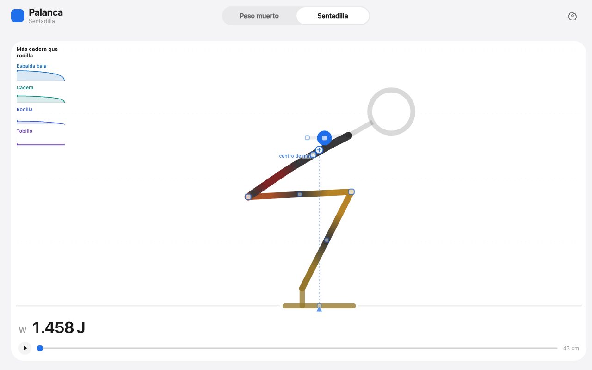

# Palanca

Simulador interactivo de la mecánica del **peso muerto** y la **sentadilla**. Tocás la figura, ajustás postura o proporciones, y ves en el mismo dibujo dónde cae la carga en cada articulación.

Corre entero en el navegador: sin backend.




## Qué hace

- Resuelve el equilibrio del sistema cuerpo + barra (modelo plano, cuasi-estático).
- Muestra momentos articulares y el trabajo del levantamiento.
- Colorea el esqueleto según la demanda (mapa de carga).
- Permite scrubear el recorrido y comparar patrones (cadera dominante, low bar, etc.).

## Cómo se usa

1. Elegí **Peso muerto** o **Sentadilla**.
2. Tocá una parte del dibujo (rodilla, barra, tibia…) para ajustar.
3. Reproducí o arrastrá el scrubber para ver el recorrido.
4. Abrí el engranaje para carga, cuerpo y opciones de vista.

## Desarrollo

```bash
npm install
npm run dev
```

```bash
npm run build
npm run test
```
