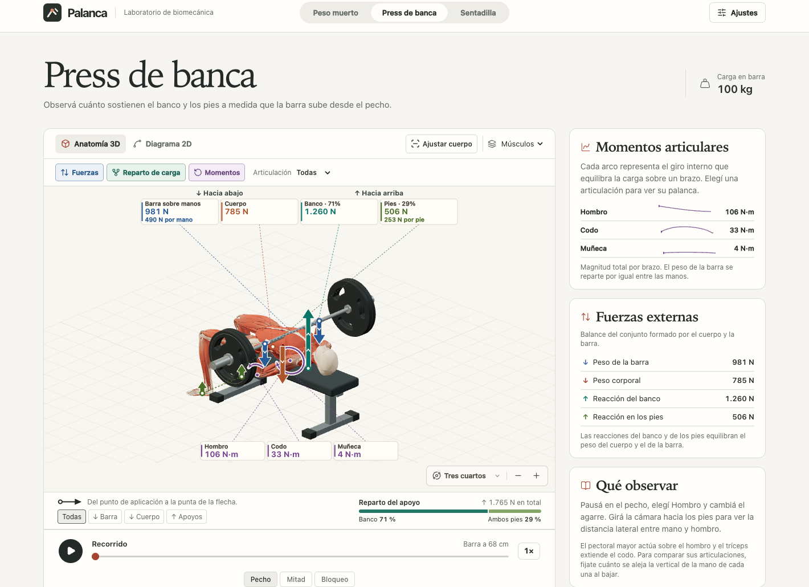

# Palanca

Laboratorio interactivo de **peso muerto, press de banca y sentadilla**. Cambiá la apertura de los pies, el agarre o las proporciones del cuerpo y seguí en 3D cómo se modifican la postura, el recorrido de la barra y los momentos articulares.


## Explorar un levantamiento

1. En **Peso muerto**, pausá en **Despegue** y alterná entre **Convencional** y **Sumo**. Mirá de frente para ver dónde quedan las manos respecto de las rodillas. De perfil podés seguir la inclinación del tronco y la distancia de la cadera a la vertical de la barra.
2. En **Sentadilla**, elegí **Fondo** y abrí la base con el deslizador. **Comparar posturas** dibuja los dos perfiles a la misma escala y en el mismo porcentaje del recorrido alcanzable. El tramo violeta une la cadera con la vertical de la barra. **Seguir cadera** o **Seguir rodilla** identifica la articulación en el dibujo.
3. En **Press de banca**, pausá en **Pecho** y variá el ancho de agarre. La vista desde los pies muestra la separación lateral entre la mano y el hombro. Los arcos siguen los momentos de hombro, codo y muñeca, por brazo.
4. **Reparto de carga** muestra el peso de la barra sobre el cuerpo y la reacción en cada apoyo. Cada flecha nace en el punto marcado y apunta en el sentido de la fuerza. Podés aislar la barra, el cuerpo o los apoyos. Al desactivar el reparto aparecen las fuerzas externas sobre el conjunto cuerpo y barra.
5. Activá **Ajustar cuerpo** y tocá un segmento para modificar sus medidas. Por ejemplo, alargá el fémur y observá la posición de la cadera a la misma altura de barra. **Ver fuerzas al ajustar** mantiene visibles los vectores durante la edición.
6. Podés girar el modelo, explorar los grupos musculares por selección, cambiar al esqueleto o al diagrama 2D y copiar un enlace desde **Ajustes**. El enlace conserva las medidas, las variantes y los anchos de base.



## Cómo interpretar los valores

El modelo equilibra cada postura con fuerzas verticales y expresa la demanda interna en N·m. En peso muerto y sentadilla, los momentos de cadera, rodilla y tobillo corresponden a una pierna. L5/S1 corresponde al tronco completo. Seleccionar una articulación muestra la contribución de la barra y de los segmentos corporales. En el despegue del peso muerto, las manos sostienen toda la carga.

En banca cada mano sostiene la mitad del peso de la barra. El modelo usa un apoyo vertical equivalente bajo los hombros y otro entre los pies. Las mediciones de un press real también incluyen aceleración y fuerzas horizontales que varían con el agarre. [Larsen y colaboradores (2021)](https://pubmed.ncbi.nlm.nih.gov/33554113/)

La apertura se mide entre los centros de los pies. El modelo gira los pies hacia afuera y modifica la posición lateral de las rodillas y la longitud proyectada de los segmentos. Calcula las palancas de perfil y supone apoyo simétrico. En una persona también intervienen fuerzas laterales y momentos en otros planos. Para contrastar estas simplificaciones con mediciones experimentales, ver los estudios sobre [peso muerto convencional y sumo](https://pubmed.ncbi.nlm.nih.gov/10912892/) y [distintas aperturas en sentadilla](https://pubmed.ncbi.nlm.nih.gov/30026952/).

El atlas permite seleccionar un grupo para estudiar su función durante el movimiento. El color anatómico se mantiene durante la repetición. Las mallas se sirven junto con la aplicación y el diagrama 2D sigue disponible si falla WebGL. [Fuentes y licencias del atlas](public/anatomy/creditos.html)


## Desarrollo y verificación

```sh
npm ci
npm run dev
```

```sh
npm run build
npm test
npm run audit:motion
```

La [auditoría de animaciones](docs/auditoria-animaciones.md) reúne los problemas corregidos, los recorridos evaluados y los controles probados en el navegador.
